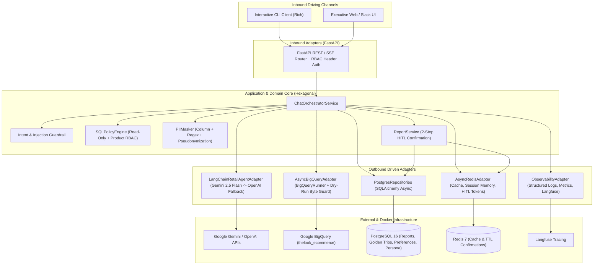

# High-Level Design (HLD) — Retail Data Analysis Chat Assistant

## 1. System Architecture Diagram (Mermaid)

## 2. Production Solutions Across All 8 Requirements

1. **Hybrid Intelligence ("Golden Knowledge" Bucket):**
   - Historical analyst-verified trios (`Question -> SQL Query -> Analyst Report`) are stored in PostgreSQL (`golden_trios`) and retrieved at query time (`search_similar_trios`) to ground metric definitions (e.g., defining retail order churn as `(Cancelled + Returned) / Total Orders` or ARPU on `Complete` orders).
   - **Production Update Loop:** Reports receiving executive thumbs-up / analyst sign-off are promoted into the Golden Bucket via an async curation queue after automated SQL validation and PII scrubbing.
2. **Safety & PII Masking + Product-Level RBAC:**
   - **Guardrail Layer:** `classify_and_guard` blocks prompt injections, SQL mutation attempts, and non-retail off-topic queries before any SQL generation occurs.
   - **SQL Firewall & Product RBAC (`SQLPolicyEngine`):** Strictly enforces `SELECT`/`WITH` queries against the 4 allowlisted tables (`orders`, `order_items`, `products`, `users`). For `CATEGORY_MANAGER` users (or any user with `allowed_categories`/`allowed_departments`), the policy engine rewrites references to `products` into a scoped CTE (`__scoped_products`) filtered by their authorized categories/departments.
   - **Zero-PII Output (`PIIMasker`):** Redacts `email`, `first_name`, `last_name`, `street_address`, `postal_code`, `latitude`, `longitude`, pseudonymizes `user_id` via salted SHA-256 (`CUST_...`), and scans final natural-language responses with regex scrubbers.
3. **High-Stakes Oversight (Destructive Ops):**
   - Deleting saved reports (`"Delete all reports mentioning Client X"` or `"Delete all the reports we made in this conversation"`) never executes directly. `ReportService.prepare_deletion` queries only reports owned by `user.user_id`, stages a short-lived `PendingConfirmation` token in Redis (`TTL=600s`), and requires explicit confirmation via `POST /api/v1/chat/confirm` before deleting.
4. **Continuous Improvement (User & System Level):**
   - **User Level:** `UserPreferenceProfile` persists per-user formatting preferences (`tables` vs `bullets`), analysis depth (`concise` vs `deep_dive`), and visual preferences across sessions.
   - **System Level:** Successful self-corrected SQL queries and high-rated executive reports are logged with trace IDs for offline golden-set expansion and prompt regression evaluation.
5. **Resilience & Graceful Error Handling:**
   - **SQL Self-Correction Loop:** Syntax errors, policy rejections, or unexpected empty (`0`-row) results trigger up to `MAX_SQL_RETRIES=3` targeted repair iterations passing BigQuery error feedback back to LangChain, bounded by `BQ_MAX_BYTES_BILLED` and `LIMIT` caps.
   - **Provider Fallback:** LangChain chains `ChatGoogleGenerativeAI` with `ChatOpenAI` fallback (`with_fallbacks`), while Redis/BigQuery adapters degrade gracefully without crashing the API.
6. **Quality Assurance:**
   - Pre-deployment CI gates combine deterministic unit tests (`pytest` for PII redaction, SQL RBAC injection, HITL confirmation), execution-accuracy benchmarks against a curated Golden Trio evaluation set, and LLM-as-a-Judge faithfulness checks.
7. **Observability:**
   - Every request receives a unique `trace_id` spanning guardrail classification, Golden Trio retrieval, SQL generation attempts, BigQuery execution latency/bytes, PII redaction counters, and final synthesis, exported to structured JSON logs, `/api/v1/metrics`, and Langfuse.
8. **Agility (CEO Persona Management):**
   - `GET/PUT /api/v1/persona` (and `/persona` in CLI) stores active tone and reporting instructions in PostgreSQL, allowing non-developers to update assistant tone weekly with zero code changes or container redeployment.
