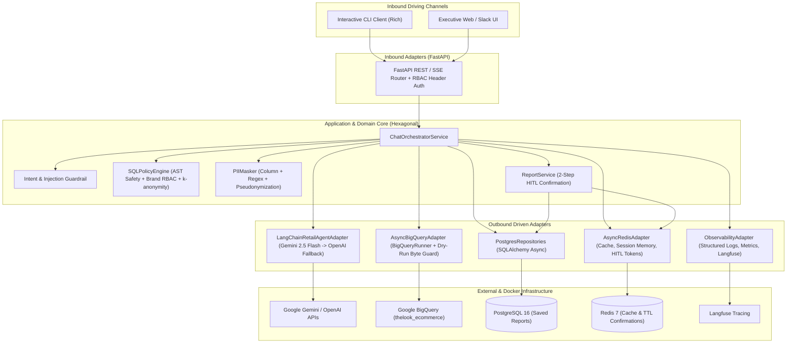

# High-Level Design (HLD) — Retail Data Analysis Chat Assistant

## 1. System Architecture Diagram (Mermaid)

## 2. Production Solutions Across All 8 Requirements

1. **Hybrid Intelligence ("Golden Knowledge" Bucket) — design only:**
   - The prototype does not implement or persist a Golden Bucket. In production, analyst-approved `Question -> SQL -> Report` examples would be stored in a versioned knowledge service, retrieved semantically, and passed through the same SQL/PII policies before use.
   - Reports would enter the bucket only after analyst approval, automated regression checks, and PII scrubbing.
2. **Safety & PII Masking + Brand RBAC:**
   - **Guardrail Layer:** `classify_and_guard` blocks prompt injections, SQL mutation attempts, and non-retail off-topic queries before any SQL generation occurs.
   - **SQL Firewall (`SQLPolicyEngine`):** parses BigQuery SQL with SQLGlot, permits one read-only query over four allowlisted tables, rejects source PII columns even when aliased, and rejects wildcard projections. Non-CEO users must have brand claims or access fails closed.
   - **Multi-brand isolation:** the policy prepends non-recursive CTEs for authorized products and derives scoped `order_items`, `orders`, and `users`. Every reference in the generated query is rewritten to those CTEs, so a mixed order contributes only its authorized item rows and foreign-brand-only customers/orders are unreachable.
   - **Demographic privacy:** `age`, `gender`, `city`, `state`, `country`, and `traffic_source` are accepted only as qualified `users` grouping dimensions with a conjunctive `HAVING COUNT(DISTINCT user) >= 5` guard (configurable).
   - **Zero-PII boundary (`PIIMasker`):** query rows are masked before cache/LLM use; all provider messages are masked immediately before the shared LangChain invocation; final text, previews, SQL, reports, confirmations, and cache hits are masked again.
3. **High-Stakes Oversight (Destructive Ops):**
   - Deleting saved reports (`"Delete all reports mentioning Client X"` or `"Delete all the reports we made in this conversation"`) never executes directly. `ReportService.prepare_deletion` queries only reports owned by `user.user_id`, stages a short-lived `PendingConfirmation` token in Redis (`TTL=600s`), and requires explicit confirmation via `POST /api/v1/chat/confirm` before deleting.
4. **Continuous Improvement — design only:**
   - The prototype applies a formatting preference only to the current request and does not persist user habits. Production would use a consent-aware profile service with audit history and deletion controls.
   - Approved traces and reports would feed an offline evaluation/curation pipeline; runtime self-learning is intentionally excluded.
5. **Resilience & Graceful Error Handling:**
   - **SQL Self-Correction Loop:** Syntax errors, policy rejections, or unexpected empty (`0`-row) results trigger up to `MAX_SQL_RETRIES=3` targeted repair iterations passing BigQuery error feedback back to LangChain, bounded by `BQ_MAX_BYTES_BILLED` and `LIMIT` caps.
   - **Provider Fallback:** LangChain's maintained `Runnable.with_fallbacks()` chains configured providers; provider clients own their timeouts/retries. Redis/BigQuery adapters degrade gracefully without crashing the API.
6. **Quality Assurance:**
   - Pre-deployment CI gates combine deterministic unit tests (`pytest` for PII redaction, SQL RBAC injection, HITL confirmation), execution-accuracy benchmarks against a curated Golden Trio evaluation set, and LLM-as-a-Judge faithfulness checks.
7. **Observability:**
   - Every request receives a unique `trace_id` spanning guardrail classification, schema retrieval, SQL generation attempts, BigQuery execution latency/bytes, PII redaction counters, and final synthesis, exported to structured JSON logs, `/api/v1/metrics`, and Langfuse.
8. **Agility (CEO Persona Management) — design only:**
   - Production would store versioned, approved persona instructions in a small configuration service with RBAC, audit log, validation, rollback, and cache invalidation. The prototype uses one environment-configured default tone and exposes no persona-management API.
