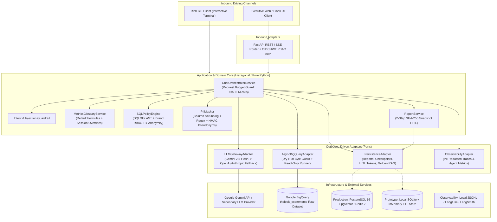
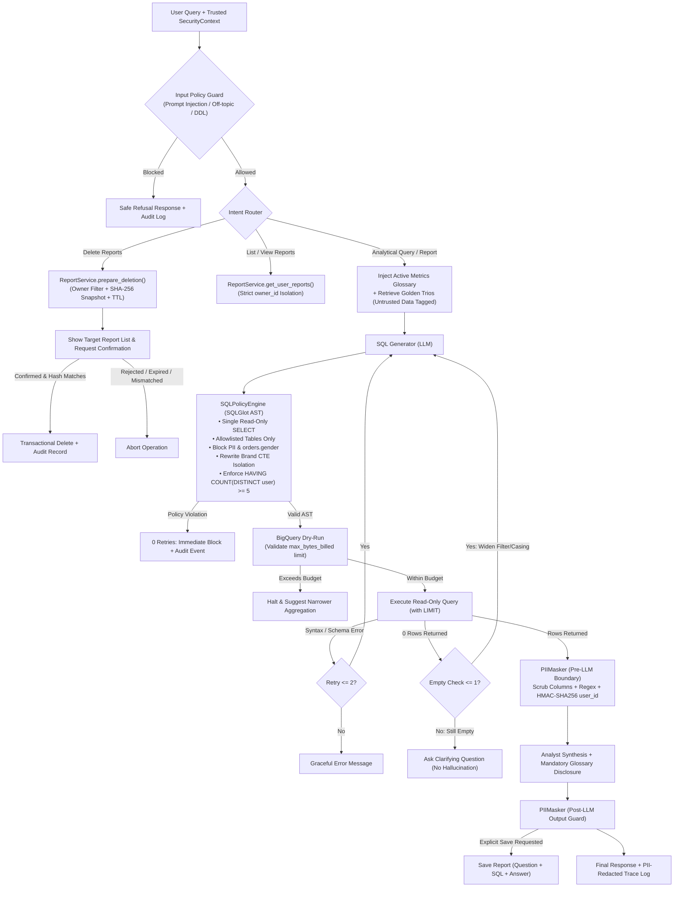
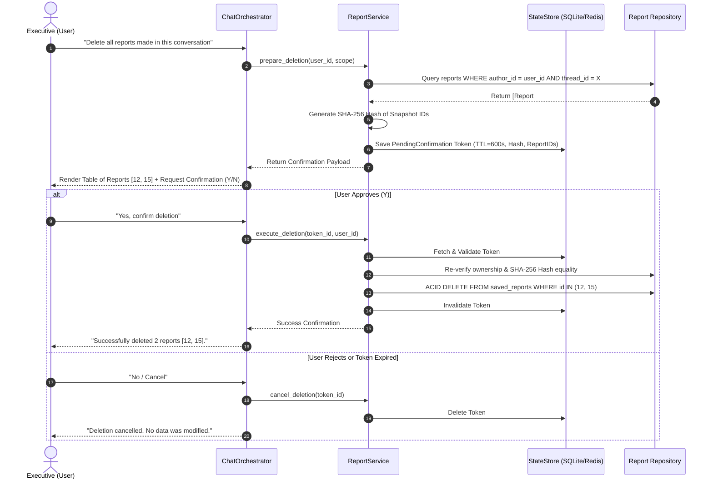
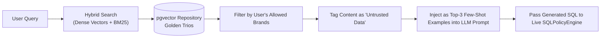
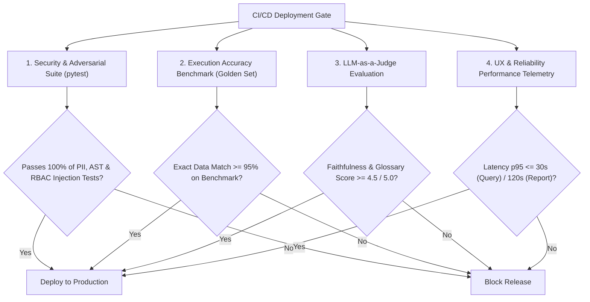
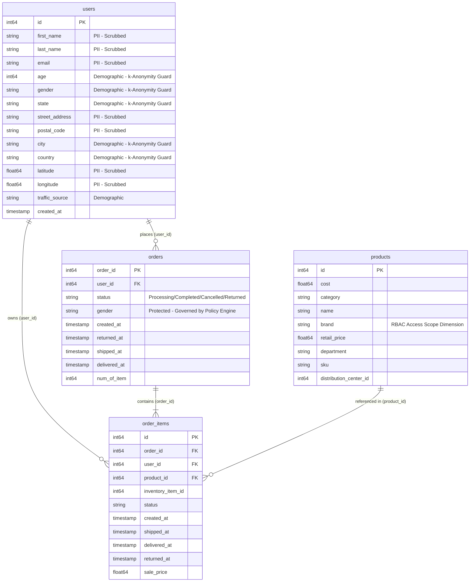

# High-Level Design (HLD) — Retail Data Analysis Chat Assistant

## 1. Executive Summary & Architectural Principles

The **Retail Data Analysis Chat Assistant** is an enterprise-grade AI system designed for non-technical executive teams (e.g., OpsFleet executive managers, CEOs) to query complex retail transactional data in natural language. The system executes dynamic SQL queries over Google BigQuery's public dataset (`bigquery-public-data.thelook_ecommerce`), synthesizes business insights, manages saved report libraries, and provides structured executive summaries.

### Core Architectural Principles
* **Domain-Driven Design (DDD):** Domain logic, security governance, and analytical policies are decoupled from infrastructure adapters.
* **Hexagonal Architecture (Ports & Adapters):** Core business logic relies purely on abstract interfaces. Infrastructure components (LLM providers, relational databases, analytical data warehouses, CLI/Web adapters) can be swapped seamlessly without touching core domain services.
* **Single Responsibility Principle (SRP):** Each agent, service, and policy module owns exactly one operational domain (e.g., AST security, PII scrubbing, report lifecycle).
* **KISS & YAGNI:** The system architecture defines a dual-profile deployment model. The prototype runs natively as a zero-dependency CLI application using local SQLite and in-memory storage, while the production design defines a scalable containerized architecture.
* **DRY (Don't Repeat Yourself):** Shared policies (such as $k$-anonymity enforcement and Zero-PII scrubbing) are centralized in reusable policy engines.

---

## 2. System Architecture & Topology

The system uses a **Dual-Profile Deployment** approach:
1. **Prototype Profile (KISS / Zero-Docker):** Driven by an interactive `Rich CLI` client, utilizing `SQLite` for report storage, state check-pointing, and structured JSON tracing, alongside an in-memory TTL store for confirmation tokens.
2. **Production Profile (Cloud-Agnostic / Containerized):** Driven by a `FastAPI` REST/SSE router behind an API Gateway, backed by `PostgreSQL 16` (`pgvector` enabled), `Redis 7` for session cache/HITL tokens, and `OpenTelemetry` + `LangSmith`/`Langfuse` for distributed tracing.



---

## 3. End-to-End Execution & Security Flow

The system processes incoming queries through a strict multi-tier execution pipeline where security rules, brand isolation, and demographic privacy policies are enforced deterministically in Python code before queries execute against BigQuery or data reaches the LLM.



---

## 4. Detailed Specification Across All 8 Requirements

### 4.1. Safety, PII Masking & Brand RBAC (Prototype + Production)

* **Security Principle:** LLMs generate analytical intents, but security, access control, and privacy boundaries are enforced deterministically in code.
* **Authentication & Identity (`SecurityContext`):**
  * In the CLI prototype, identity is loaded from a trusted YAML profile (`configs/users_rbac.yaml`) or CLI startup flag.
  * In Production, the API Gateway parses a signed OIDC/JWT token and constructs an immutable `SecurityContext(user_id, role, allowed_brands)`.
  * **Brand RBAC:** Access control is scoped strictly by `brand`. Brand managers query data associated with their assigned brands. Users with the `CEO` role have unrestricted access across all brands. If a non-CEO user has no assigned brands, access fails closed.
* **Dynamic SQL AST Policy Engine (`SQLPolicyEngine` via `SQLGlot`):**
  * Parses generated BigQuery SQL into an AST.
  * Permits exactly **one read-only SELECT statement** over four allowlisted tables: `orders`, `order_items`, `products`, `users`.
  * Rejects DML (`INSERT`, `UPDATE`, `DELETE`), DDL (`DROP`, `ALTER`), wildcard projections (`SELECT *`), system schema queries, and subqueries accessing external datasets.
  * **Multi-Brand Row/CTE Isolation:** Automatically injects non-recursive CTEs scoping products, order items, orders, and users to the user's authorized brands:
    ```sql
    WITH _scoped_products AS (
      SELECT * FROM `bigquery-public-data.thelook_ecommerce.products`
      WHERE brand IN ('BrandA', 'BrandB')
    ),
    _scoped_order_items AS (
      SELECT oi.* FROM `bigquery-public-data.thelook_ecommerce.order_items` oi
      INNER JOIN _scoped_products p ON oi.product_id = p.id
    ),
    _scoped_orders AS (
      SELECT o.* FROM `bigquery-public-data.thelook_ecommerce.orders` o
      WHERE EXISTS (SELECT 1 FROM _scoped_order_items soi WHERE soi.order_id = o.order_id)
    ),
    _scoped_users AS (
      SELECT u.* FROM `bigquery-public-data.thelook_ecommerce.users` u
      WHERE EXISTS (SELECT 1 FROM _scoped_order_items soi WHERE soi.user_id = u.id)
    )
    -- All table references in the original query are rewritten to point to these scoped CTEs
    ```
* **Demographic Privacy & $k$-Anonymity Protection:**
  * Demographics (`city`, `state`, `country`, `age`, `gender`, `traffic_source`) are prohibited as raw unaggregated fields.
  * Demographic attributes are permitted only as grouping dimensions when paired with a compulsory `HAVING COUNT(DISTINCT user_id) >= k` clause (default $k=5$, configurable).
  * **AST Leakage Prevention:** Rejects queries referencing `orders.gender` directly without $k$-anonymity validation to prevent schema bypasses around `users.gender`.
* **Zero-PII Perimeter (`PIIMasker`):**
  * Explicit PII columns (`first_name`, `last_name`, `email`, `street_address`, `postal_code`, `latitude`, `longitude`, `user_geom`) are blocked at the SQL AST level.
  * Before query results reach the LLM or cache, raw numeric `user_id` values are converted to stable deterministic pseudonyms:
    $$\text{Pseudonym} = \text{HMAC-SHA256}(\text{user\_id}, \text{SecretSalt})[:12]$$
  * High-entropy patterns (emails, phone numbers, addresses) are scrubbed via Regex before LLM prompt assembly and final output rendering.

---

### 4.2. High-Stakes Oversight: Destructive Operations (Prototype + Production)

* **Scope & Ownership:** Saved reports (containing `question`, `sql`, `answer`, `author_id`) can only be read or modified by their creator (`author_id == user_id`).
* **Two-Step Confirmation Workflow (Anti-TOCTOU):**
  1. **Preparation Phase:** Upon receiving a destructive command (e.g., *"Delete all reports mentioning Client X"*), `ReportService.prepare_deletion` resolves matching report IDs owned by `user_id`, takes an immutable snapshot, computes a SHA-256 payload hash, and generates a single-use confirmation token stored with a 600-second TTL:
     $$\text{PayloadHash} = \text{SHA256}(\text{SortedReportIDs} \mathbin{\Vert} \text{user\_id} \mathbin{\Vert} \text{nonce})$$
  2. **User Presentation:** The CLI/UI displays the exact list of target reports (ID, title, creation date, summary snippet) and prompts for explicit confirmation (`yes/no` or button click).
  3. **Execution Phase:** Upon confirmation, the service verifies that the token is active, matches `user_id`, and that the SHA-256 hash of current target IDs matches the snapshot hash. If valid, deletion executes within a single ACID transaction, generating a security audit log.



---

### 4.3. Resilience & Graceful Error Handling (Prototype + Production)

* **SQL Self-Correction Loop:**
  * **Syntax & Schema Errors:** If BigQuery returns a syntax error or missing column fault, the error message is fed back to the LLM for targeted repair, capped at `MAX_SQL_RETRIES = 2`.
  * **Security Policy Rejections:** If `SQLPolicyEngine` rejects a generated query due to AST/RBAC violations, retries are capped at `0`. The query fails fast to prevent the model from probing security boundaries.
  * **Empty Result Handling ($0$ Rows):** If a valid query returns $0$ rows, the system attempts **1 bounded retry** to check case sensitivity (e.g., `'California'` vs `'CALIFORNIA'`) or widen restrictive date filters. If results remain empty, the agent returns a graceful explanation and asks a clarifying question without inventing data.
* **LLM Provider Fallback Strategy:**
  * Primary Provider: `Google Gemini 2.5 Flash` (via Google AI Studio / GCP Vertex AI).
  * Secondary Fallback: Managed `LLMGateway` switches to `OpenAI (GPT-4o)` or `Anthropic (Claude 3.5 Sonnet)` on HTTP 429 (Rate Limit), 5xx Server Errors, or API timeouts using `Runnable.with_fallbacks()`.
* **Cost & Byte Control Guards:**
  * Every SQL statement undergoes a BigQuery `dry_run` pre-execution check. If `total_bytes_processed` exceeds the configured cap (`BQ_MAX_BYTES_BILLED = 100 MB` for prototype, `1 GB` for production), execution halts and the user is prompted to request a narrower query window.
  * **Request Budget Guard:** Enforces a strict upper bound of **$\le 5$ LLM calls** and **$\le \$1.00$ compute cost** per user query turn.

---

### 4.4. Observability & Debugging (Prototype + Production)

* **Correlation Tracing:** Every request generates a unique `trace_id` propagated across all internal calls (Guardrails, Schema Resolution, AST Policy Validation, BigQuery execution, PII Redaction, Synthesis).
* **Tracked Metrics:**
  * **Agent Performance:** Query latency (p50, p95, p99), LLM time-to-first-token (TTFT), token usage (prompt/completion), cost per query.
  * **Data & Policy Metrics:** BigQuery bytes billed, AST policy violation counts, PII redaction counters, SQL self-correction attempt rates.
  * **System Reliability:** LLM provider fallback counts, $0$-row return frequencies, HITL deletion confirmation/cancellation rates.
* **PII-Scrubbed Logging:**
  * All trace events, prompts, and tool payloads pass through `PIIMasker` **prior to storage or export**. Raw customer names, emails, and exact coordinates never reach trace logs.
  * **Prototype:** Structured JSONL files written locally to `logs/agent_traces.jsonl` alongside SQLite event records.
  * **Production:** `OpenTelemetry` SDK exporting traces to `LangSmith` or `Langfuse` with structured JSON logs sent to centralized logging (e.g., CloudWatch / GCP Cloud Logging).

---

### 4.5. Hybrid Intelligence: "Golden Knowledge" Bucket (Design-Only HLD)

* **Concept:** Human analysts create curated "Trios" consisting of $(\text{Natural Language Question}, \text{Optimized SQL Query}, \text{Analyst Report})$.
* **Storage & Indexing Pipeline:**
  * Expert-approved Trios are stored in a versioned Knowledge Service backed by PostgreSQL (`pgvector`).
  * Hybrid Search: Combines Dense Vector Embeddings (semantic intent match) with Sparse Keyword Search (BM25 for exact business terms and brand names).
* **Query-Time Retrieval & Injection:**
  1. User query triggers semantic search over Golden Trios filtered by `allowed_brands`.
  2. Top-$K$ ($K=3$) relevant examples are retrieved and tagged as **`untrusted historical data`** inside the prompt context to prevent prompt injection.
  3. The LLM uses these examples to mirror domain logic, but the newly generated SQL must still pass the live user's `SQLPolicyEngine` AST firewall.
* **Continuous Bucket Lifecycle:**
  * Production queries enter the Golden Bucket candidate queue only after: (a) Explicit user approval, (b) Human analyst review, (c) Automated regression testing, and (d) Complete PII scrubbing.



---

### 4.6. Continuous Improvement: The Learning Loop (Design-Only HLD)

* **User-Level Adaptation (Preferences Profile):**
  * Tracks user presentation preferences (e.g., preference for tables vs bullet points, analytical depth, default formatting).
  * Preferences are stored in a explicit user profile store: `UserProfile(user_id, output_format, depth_level, auto_chart_enabled)`.
  * **Consent & Transparency:** Preferences update only through explicit user commands (e.g., *"Always show results in tables"*) or confirmed prompt prompts, avoiding silent drift. Users can inspect and reset their preference profiles.
* **System-Level Evaluation & Optimization Pipeline:**
  * Offline pipeline ingests negative feedback ($\text{thumbs down}$, query edits, failed SQL traces).
  * Failed queries are clustered to identify missing schema glossary terms, ambiguous column mappings, or LLM syntax traps.
  * Periodic prompt updates and fine-tuning datasets are evaluated offline before deployment. Real-time online model updating is explicitly excluded to prevent prompt injection poisoning.

---

### 4.7. Quality Assurance & Evaluation Framework (Design-Only HLD)

Pre-deployment validation combines deterministic security test suites, execution benchmarks, and automated judge metrics:



* **Test Suites & Evaluation Criteria:**
  1. **Deterministic Security Suite (`pytest`):** Verifies PII redaction, brand CTE isolation, $k$-anonymity enforcement, `orders.gender` restriction, and HITL deletion snapshot token validation.
  2. **Execution Accuracy Benchmark:** Compares BigQuery DataFrame outputs produced by agent-generated SQL against ground-truth DataFrames over a reference evaluation dataset (evaluating data equivalence rather than exact SQL string equality).
  3. **LLM-as-a-Judge Evaluation:** Evaluates final synthesized reports for **Faithfulness** (no hallucinations beyond executed SQL results), **Completeness** (addresses user question), and **Glossary Compliance** (correctly applies metric definitions).
  4. **UX & SLA Performance Telemetry:**
     * Simple Query Latency Target: $p50 < 10\text{s}$, $p95 < 30\text{s}$.
     * Complex Report Latency Target: $p50 < 45\text{s}$, $p95 < 120\text{s}$.
     * Clarification Rate Target: $< 8\%$ of incoming user queries.

---

### 4.8. Agility: Persona & Tone Management (Design-Only HLD)

* **Architecture Isolation:** System Guardrails (security, AST rules, PII scrubbing, metrics formulas) are immutably baked into application code and system prompt headers. Persona instructions are injected into an isolated, configurable XML prompt block:
  ```xml
  <system_instructions>
    <!-- Immutable Security & Policy Rules -->
  </system_instructions>
  <persona_configuration version="2.1" updated_by="CEO_Office">
    <!-- Non-developer configurable tone, executive style, narrative preferences -->
    Tone: Concise, direct, executive-ready. Highlight key risks first.
  </persona_configuration>
  ```
* **Management & Governance:**
  * Non-developer administrators update tone configuration via a lightweight Admin UI or configuration API backed by a version-controlled store (`PersonaConfigStore`).
  * Every update creates a new version record with audit logs (`editor_id`, `timestamp`, `diff`).
  * Features a one-click rollback mechanism to revert to previous tone definitions instantly if analytical clarity is impacted.

---

## 5. Domain Glossary & Business Metrics Framework

To resolve metric ambiguities across disparate business units, the system introduces a **`MetricsGlossaryService`**. Default definitions are stored in a central configuration (`configs/business_glossary.yaml`) and injected into the LLM system prompt.

### Standard Default Metric Rules
* **Churned Customer:** Any customer with zero completed purchases within the last 90 consecutive days:
  $$\text{Churned}(u) \iff \neg \exists \text{ order } o \text{ where } o.user\_id = u.id \text{ AND } o.created\_at \ge (\text{CURRENT\_TIMESTAMP} - 90\text{ days}) \text{ AND } o.status = \text{'Complete'}$$
* **Net Revenue:** Total sales price of order items excluding cancelled or returned items:
  $$\text{Net Revenue} = \sum (\text{order\_items.sale\_price}) \quad \forall \text{ items WHERE } \text{status NOT IN ('Cancelled', 'Returned')}$$
* **Active User Grouping:** Demographic aggregations require a distinct count of users meeting the threshold:
  $$\text{Demographic Filter} \implies \text{HAVING COUNT(DISTINCT user\_id)} \ge k \quad (k=5)$$

### Dynamic Disclosure & User Overrides
1. **Mandatory Disclosure:** Every generated analyst response includes an **"Applied Metric Definitions"** footer detailing the formulas used during computation.
2. **Session Overrides:** Executives can override metric parameters in conversation (e.g., *"Calculate churn using 60 days instead of 90"*). The `MetricsGlossaryService` overrides the parameter for the duration of the current session thread without modifying system defaults.

---

## 6. Schema Architecture & Data Mapping

The assistant operates against four primary tables within `bigquery-public-data.thelook_ecommerce`:



---

## 7. Operational Trade-Offs & Production Strategy

| Component / Layer | Prototype Profile (KISS / CLI) | Production Profile (Cloud-Agnostic) | Architectural Rationale & Trade-Offs |
| :--- | :--- | :--- | :--- |
| **Interface / Inbound** | `Rich CLI` (Terminal UI) | `FastAPI` (REST / SSE) + Web UI | CLI provides instant zero-dependency testing; Web API supports enterprise streaming. |
| **Authentication & RBAC** | Local YAML config (`users_rbac.yaml`) | OIDC / OAuth2 JWT (Cognito, Keycloak, Auth0) | Production delegates token validation to standard Identity Providers. |
| **Data Warehouse Access** | BigQuery Client (Service Account) | BigQuery Client with Bounded Quotas | Direct execution over raw public BigQuery dataset using AST policy rewriting. |
| **Persistence (Reports & State)** | `SQLite` (`reports.db`, `checkpoints.db`) | `PostgreSQL 16` (`RDS` / `Cloud SQL`) | SQLite requires no container orchestration; PostgreSQL supports concurrent scaling. |
| **Cache & HITL Storage** | In-Memory TTL Store | `Redis 7` Cluster | Memory store simplifies local CLI runs; Redis supports multi-instance session caching. |
| **Vector Search (Golden Bucket)**| Disabled (Described in HLD) | `pgvector` / OpenSearch / Pinecone | Avoids vector index setup in prototype while defining semantic search in HLD. |
| **Observability & Tracing** | Local JSONL + SQLite Trace Log | OpenTelemetry + `LangSmith` / `Langfuse` | Local file logging avoids third-party dependencies; OpenTelemetry enables full distributed tracing. |

---

## 8. Prototype Project Structure

```text
retail-analytics-agent/
├── src/
│   ├── core/                        # Application & Domain Core (Framework Agnostic)
│   │   ├── domain/                  # Entities, Value Objects, Domain Policies
│   │   │   ├── security_context.py  # User Identity, Role & Allowed Brands
│   │   │   ├── metrics_glossary.py  # Default & Session Metric Definitions
│   │   │   └── report_entity.py     # Saved Report Domain Models & HITL Snapshot
│   │   ├── services/                # Application Services & Business Logic
│   │   │   ├── orchestrator.py      # Main Agent Loop & Request Budget Guard
│   │   │   ├── sql_policy_engine.py # AST Parser, Brand CTE Rewriter, k-Anonymity
│   │   │   ├── pii_masker.py        # Column Scrubbing, Regex, HMAC Pseudonymization
│   │   │   └── report_service.py    # Report CRUD & 2-Step Confirmation Engine
│   │   └── ports/                   # Abstract Interfaces (Hexagonal Ports)
│   │       ├── llm_port.py          # Abstract LLM Gateway
│   │       ├── database_port.py     # Abstract Query Execution Engine
│   │       ├── storage_port.py      # Abstract Persistence Gateway
│   │       └── tracer_port.py       # Abstract Observability Interface
│   │
│   ├── adapters/                    # Outbound Driven Adapters
│   │   ├── llm/
│   │   │   └── langchain_adapter.py # Gemini 2.5 Flash -> OpenAI Fallback Adapter
│   │   ├── database/
│   │   │   └── bigquery_adapter.py  # Async BigQuery Runner + Dry-Run Byte Guard
│   │   ├── storage/
│   │   │   ├── sqlite_adapter.py    # Local SQLite Storage (Reports & Checkpoints)
│   │   │   └── memory_ttl_store.py  # In-Memory HITL Confirmation Token Store
│   │   └── observability/
│   │       └── json_tracer.py       # PII-Redacted Structured JSON Tracing
│   │
│   └── inbound/                     # Inbound Driving Adapters
│       └── cli/
│           ├── app.py               # Rich CLI Application Loop
│           └── formatting.py        # Terminal Tables, Markdown & Color Renderers
│
├── configs/                         # System Configuration Files
│   ├── users_rbac.yaml              # Local User Identity & Brand Access Mappings
│   ├── business_glossary.yaml       # Default Churn, Revenue & Metric Definitions
│   └── persona_config.yaml          # CEO Tone & Response Style Rules
│
├── tests/                           # Security, Integration & Unit Test Suites
│   ├── test_sql_policy_engine.py    # AST Security, Brand Isolation & k-Anonymity Tests
│   ├── test_pii_masker.py           # Zero-PII Scrubbing & HMAC Pseudonym Tests
│   ├── test_report_service.py       # Deletion Confirmation Snapshot Tests
│   └── test_resilience.py           # Error Self-Correction & Fallback Tests
│
├── docs/                            # Architectural Documentation
│   └── hld_document.md              # Production High-Level Design (This Document)
│
├── requirements.txt                 # Python Dependencies
├── .env.example                     # Environment Configuration Template
└── README.md                        # Setup & Execution Instructions
```
