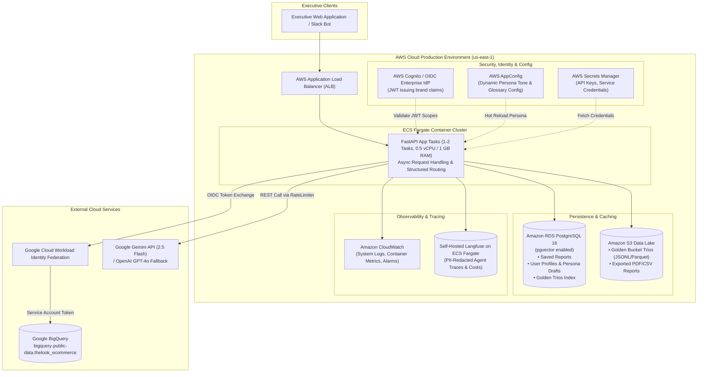
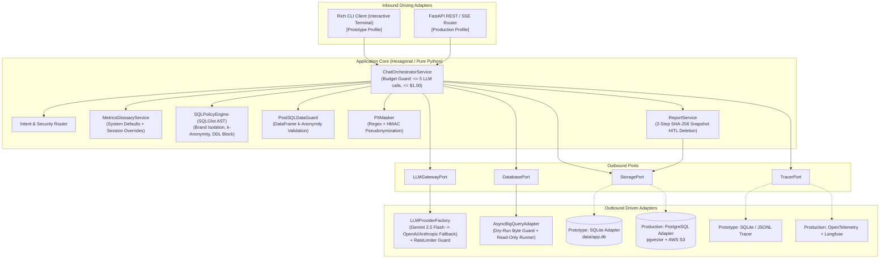
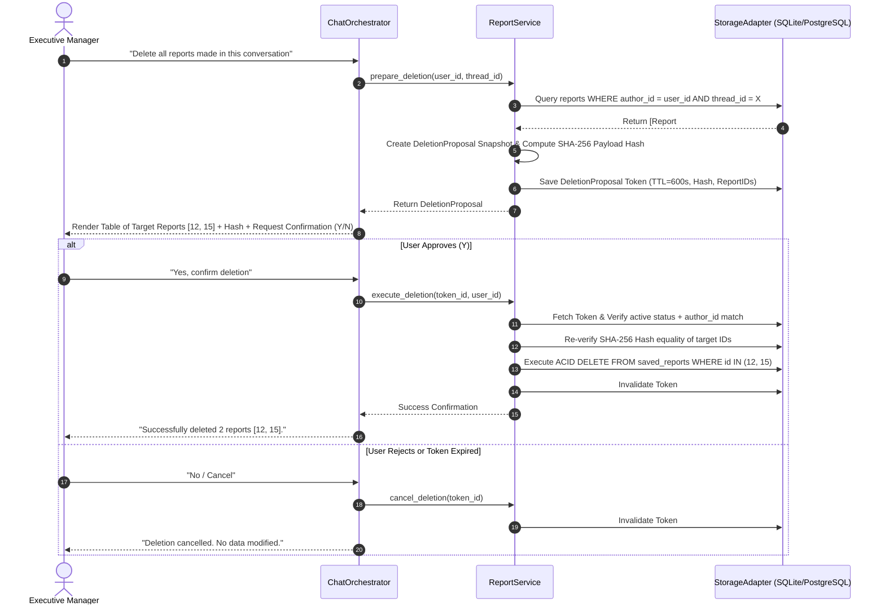
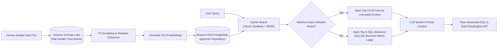
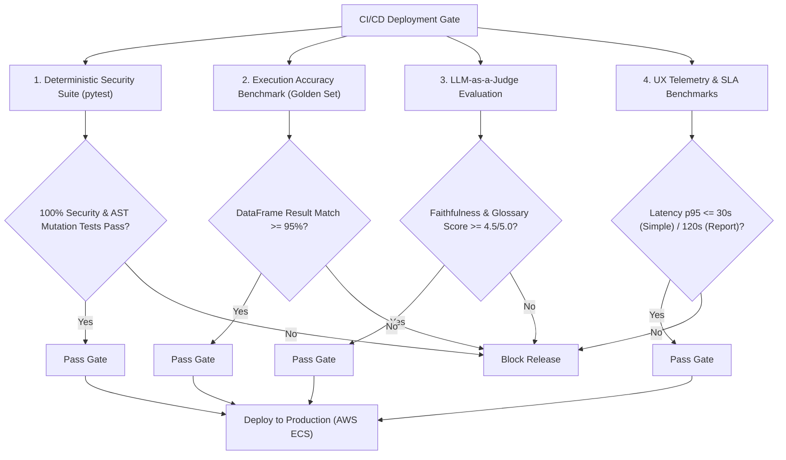
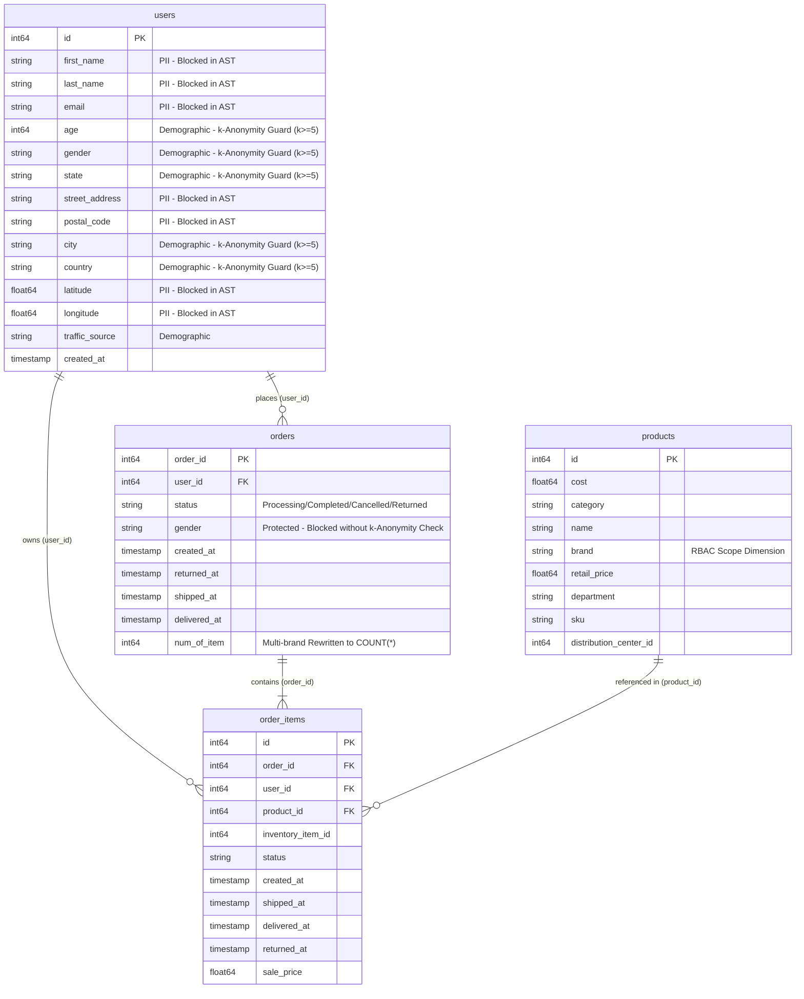

# High-Level Design (HLD) — Retail Data Analysis Chat Assistant

## 1. Executive Summary & Architectural Principles

The **Retail Data Analysis Chat Assistant** is an enterprise-grade AI solution designed for non-technical executive teams (e.g., OpsFleet executive managers, CEOs) to query complex retail transactional data using natural language. The system executes dynamic SQL queries against Google BigQuery's public dataset (`bigquery-public-data.thelook_ecommerce`), synthesizes actionable business insights, manages a library of saved executive reports, and exposes extensible hooks for future capabilities (e.g., automated charting, email distribution, web trend analysis).

### Core Architectural Principles
* **Domain-Driven Design (DDD):** Domain logic, security governance, and analytical policies are decoupled from external infrastructure adapters.
* **Hexagonal Architecture (Ports & Adapters):** Business logic interacts solely with abstract interfaces (Ports). Infrastructure components (LLM providers, analytical databases, persistence layers, CLI/Web frameworks) can be swapped seamlessly without altering core domain logic.
* **Single Responsibility Principle (SRP):** Each service, agent, and policy engine owns exactly one operational domain (e.g., AST security parsing, PII masking, report lifecycle management, metrics glossary resolution).
* **KISS & YAGNI:** A dual-profile deployment model guarantees a zero-dependency, local `Rich CLI` application running on `SQLite` for instant prototype evaluation, while providing a scalable containerized cloud architecture for production.
* **DRY (Don't Repeat Yourself):** Security boundaries, $k$-anonymity enforcement, and PII masking rules are centralized in a single domain-level `PrivacyPolicy` Value Object and reusable policy engines.

---

## 2. Framework Selection & Technical Rationale

Per assessment guidelines (Deliverable #6), the technical stack was selected based on production reliability, strict domain isolation capabilities, and architectural fit.

### Stack Specification & Rationale
1. **Core Language & Type System (Python 3.11+ & Pydantic v2):**
   * *Rationale:* Provides strong static typing, ultra-fast validation via Rust-based Pydantic core, and seamless interoperability with major AI/ML SDKs. Immutable value objects represent identity, security contexts, and analytical queries deterministically.
2. **LLM Orchestration & Fallback Framework (LangChain / Core Expression Language - LCEL):**
   * *Rationale:* Offers lightweight abstraction over multi-provider LLM integrations (Google Gemini, OpenAI, Anthropic) via unified interfaces (`BaseChatModel`). Allows declarative fallback chains (`Runnable.with_fallbacks()`), structured output parsing (`with_structured_output()`), and provider neutrality without lock-in.
3. **SQL Parsing & Security AST Engine (`SQLGlot`):**
   * *Rationale:* Pure Python SQL parser and transpiler capable of parsing BigQuery SQL dialects into Abstract Syntax Trees (AST). Enables deterministic inspection, security rule enforcement, CTE injections, and table/column allowlisting prior to query execution.
4. **Data Manipulation & In-Memory Analytics (Pandas & PyArrow):**
   * *Rationale:* Efficient DataFrame serialization of BigQuery execution results. Facilitates post-query demographic masking ($k$-anonymity verification) and PII redaction before data hits the LLM boundary.
5. **Inbound Frameworks (Rich CLI / FastAPI):**
   * *Rationale:* `Rich` powers terminal formatting (tables, syntax highlighting, progress spinners) for zero-dependency CLI execution. `FastAPI` (Production) provides asynchronous REST/SSE streaming endpoints backed by ASGI/Uvicorn.

### Architect Experience Statement
* *Experience Level:* Senior / Principal AI Solutions Architect level. Extensive hands-on experience in building enterprise-grade LLM applications, deterministic agentic workflows, function calling pipelines, and secure RAG systems on AWS and GCP. Proficient in applying DDD patterns to AI architectures, managing prompt security, and operating high-throughput analytical LLM pipelines in production.

---

## 3. Production Workload Sizing & Target AWS Infrastructure Topology

The production design is calibrated for OpsFleet's operational parameters: **~100 active executive managers per day**, generating **~10 analytical queries per manager per day** (~1,000 queries/day total), saving **~1 report per manager per day**, and requiring simple query responses within **10–30 seconds** and complex report generation within **1–2 minutes**.

### Production Infrastructure Topology (AWS + Google Cloud)



### Resource Sizing & Cost Justification
* **Compute (ECS Fargate):** 1–2 tasks running 0.5 vCPU / 1 GB RAM effortlessly handle peak concurrency ($\sim 5$ concurrent requests during business peak hours) with average utilization $<20\%$. Estimated AWS compute cost: **~$$30/month**.
* **Database (RDS PostgreSQL):** `db.t4g.small` multi-AZ instance is sufficient for storing saved reports, preferences, and vector embeddings for 100 managers. Estimated database cost: **~$$40/month**.
* **Analytical Compute (Google BigQuery):** Queries run against `bigquery-public-data.thelook_ecommerce` (~100 MB per unaggregated query, controlled via AST projection and `dry_run` byte guards). At ~1,000 queries/day (~100 GB/day processed), total usage is ~3 TB/month. With 1 TB free tier, net cost is ~2 TB $\times$ $$6.25/TB = **~$$12.50/month**.
* **LLM Compute (Gemini 2.5 Flash):** At ~1,000 questions/day with 2–3 calls per question (~2,500 calls/day, ~2M input tokens/day), cost under Gemini 2.5 Flash ($$0.075 / 1M tokens) is **< $$0.20/day** (**~$$6.00/month**), well within the **$$1.00 per query ceiling limit**.

---

## 4. Dual-Profile Deployment Model

To satisfy both prototype evaluation (zero Docker, immediate CLI run) and enterprise deployment standards, the system implements a **Dual-Profile Topology**:

1. **Prototype Profile (KISS / Zero-Docker):** Runs as an interactive terminal application (`Rich CLI`), storing saved reports, checkpoints, and execution traces in local `SQLite` databases (`data/app.db`) and structured `JSONL` logs.
2. **Production Profile (AWS Containerized):** Runs as a containerized `FastAPI` service on `AWS ECS Fargate`, utilizing `PostgreSQL 16` (`pgvector`), `AWS AppConfig`, `AWS S3`, `OpenTelemetry`, and `Langfuse`.



---

## 5. End-to-End Execution Pipeline & Security Flow

The system processes incoming queries through a multi-tier pipeline enforcing security rules deterministically in Python before queries execute against BigQuery or raw data reaches the LLM.

```mermaid
flowchart TD
    REQ["User Natural Language Query + SecurityContext"] --> PRE_GUARD{"Deterministic Pre-Guard<br/>(System Commands / PII Injection Check)"}
    PRE_GUARD -->|Blocked| REFUSE["Safe Refusal Response + Trace Event"]
    PRE_GUARD -->|Allowed| LLM_PLAN["Structured LLM Call (Intent + Glossary Override + SQL Generation)<br/>[LLM Call #1]"]

    LLM_PLAN --> ROUTE{"Intent Router"}

    ROUTE -->|Delete Reports| PREP_DEL["ReportService.prepare_deletion()<br/>(Owner Isolation + SHA-256 Snapshot + TTL 600s)"]
    PREP_DEL --> SHOW_DEL["Render Target Report List + Hash to User"]
    SHOW_DEL --> CONFIRM_DEL{"User Confirms Hash & Action?"}
    CONFIRM_DEL -->|Confirmed| EXEC_DEL["Transactional Delete + Security Audit Log"]
    CONFIRM_DEL -->|Cancelled / Expired| ABORT_DEL["Abort Operation + Retain Data"]

    ROUTE -->|List / View Reports| READ_REP["ReportService.get_user_reports()<br/>(Strict author_id Filter)"]

    ROUTE -->|Analytical Query| AST_VAL{"SQLPolicyEngine (SQLGlot AST)<br/>1. Single SELECT Only<br/>2. Allowlisted Tables Only<br/>3. Block PII & direct orders.gender<br/>4. Rewrite Brand CTE Isolation<br/>5. Inject HAVING COUNT(DISTINCT user_id) >= k"}

    AST_VAL -->|Hard Violation (PII / Brand / DML)| FAILS_FAST["0 Retries: Fail Fast + Audit Security Violation"]
    AST_VAL -->|Soft Format Failure (e.g. SELECT *)| SOFT_RETRY{"Soft Repair Attempt <= 1?"}
    SOFT_RETRY -->|Yes| LLM_PLAN
    SOFT_RETRY -->|No| REJECT_SOFT["Reject Query with Formatting Error"]

    AST_VAL -->|Valid AST| DRY["AsyncBigQueryAdapter.dry_run()<br/>(Validate total_bytes_billed <= Limit)"]
    DRY -->|Exceeds Budget| EXPENSIVE["Halt & Prompt User to Narrow Range"]
    DRY -->|Within Budget| BQ_EXEC["Execute Read-Only SQL Query"]

    BQ_EXEC -->|Syntax Error| RETRY_SYN{"Syntax Repair Attempt <= 2?"}
    RETRY_SYN -->|Yes| LLM_PLAN
    RETRY_SYN -->|No| GRACEFUL_ERR["Graceful Error Message"]

    BQ_EXEC -->|0 Rows Returned| RETRY_EMPTY{"Empty Repair Attempt <= 1?"}
    RETRY_EMPTY -->|Yes: Widen Casing / Date Filter| LLM_PLAN
    RETRY_EMPTY -->|No: Still 0 Rows| CLARIFY["Return Explanation + Ask Clarifying Question"]

    BQ_EXEC -->|Data Returned| POST_GUARD{"PostSQLDataGuard (Pandas)<br/>Verify Demographic Aggregates >= k"}
    POST_GUARD -->|Mask Below k| MASK_DF["Mask Rows Below k Threshold"]
    POST_GUARD -->|Valid| PII_STRIP["PIIMasker: Convert user_id to HMAC Pseudonym"]

    MASK_DF --> PII_STRIP
    PII_STRIP --> LLM_SYNTH["Analyst Synthesis LLM Call<br/>[LLM Call #2]"]
    LLM_SYNTH --> FOOTER["Inject Deterministic Metric Glossary Footer"]
    FOOTER --> PII_OUT["PIIMasker: Post-LLM Output Scrubbing"]
    PII_OUT --> RESP["Final Response Rendered + Trace Logged"]
```

---

## 6. Detailed Specification Across All 8 Requirements

### 6.1. Safety, PII Masking & Brand RBAC (Prototype + Production)

#### Immutable Central Security Policy (`PrivacyPolicy` Value Object)
To adhere to DRY, privacy boundaries are defined in a central `PrivacyPolicy` domain object:
* **Explicit PII Columns:** `first_name`, `last_name`, `email`, `street_address`, `postal_code`, `latitude`, `longitude`, `user_geom`.
* **Demographic Columns:** `city`, `state`, `country`, `age`, `gender`, `traffic_source`.
* **Demographic Grouping Rule:** Demographic columns are prohibited as raw unaggregated attributes. They are permitted **only** within aggregated `GROUP BY` queries enforcing `HAVING COUNT(DISTINCT user_id) >= k` (default $k=5$, configurable).
* **Schema Leakage Rules:** Direct references to `orders.gender` without $k$-anonymity checks are rejected at the AST level.

#### Identity & Brand Access Control
* **Identity Loading (`SecurityContext`):**
  * In CLI Prototype: Loaded from `configs/users_rbac.yaml` or startup flags (`--user ceo`, `--user brand_mgr`).
  * In Production: Extracted from verified JWT claims issued by AWS Cognito / OIDC provider: `SecurityContext(user_id, role, allowed_brands)`.
* **Brand Access Scope:**
  * Access is scoped strictly by **`brand`**. Brand managers can query data associated only with their assigned brands. CEOs have unrestricted access across all brands. If a non-CEO user has no assigned brands, queries fail-closed.
  * Customer and order metrics are accessible **only through purchases of in-scope products**.

#### Dynamic AST Policy Engine (`SQLPolicyEngine` via `SQLGlot`)
Parses incoming BigQuery SQL into an AST and applies deterministic transformations:
1. Rejects multi-statement queries, DML (`INSERT`, `UPDATE`, `DELETE`), DDL (`DROP`, `ALTER`), wildcard projections (`SELECT *`), and system catalog tables.
2. **Multi-Brand CTE Row Isolation:** Automatically injects non-recursive CTEs scoping products, order items, orders, users, and multi-brand metrics:
   ```sql
   WITH _scoped_products AS (
     SELECT * FROM `bigquery-public-data.thelook_ecommerce.products`
     WHERE brand IN ('BrandA', 'BrandB')
   ),
   _scoped_order_items AS (
     SELECT oi.* FROM `bigquery-public-data.thelook_ecommerce.order_items` oi
     INNER JOIN _scoped_products p ON oi.product_id = p.id
   ),
   _scoped_orders AS (
     SELECT o.* FROM `bigquery-public-data.thelook_ecommerce.orders` o
     WHERE EXISTS (SELECT 1 FROM _scoped_order_items soi WHERE soi.order_id = o.order_id)
   ),
   _scoped_users AS (
     SELECT u.* FROM `bigquery-public-data.thelook_ecommerce.users` u
     WHERE EXISTS (SELECT 1 FROM _scoped_order_items soi WHERE soi.user_id = u.id)
   )
   -- Original query references rewritten to point to _scoped_* CTEs
   ```
3. **Multi-Brand Basket Size Protection:** Direct references to `orders.num_of_item` by non-CEO users are rewritten to `COUNT(*)` over `_scoped_order_items` to prevent revealing total item counts of competitor brands in mixed-brand orders.

#### Post-SQL DataFrame Guard & Zero-PII Perimeter
* **Post-SQL Guard:** As a secondary defense-in-depth layer, `PostSQLDataGuard` inspects returned Pandas DataFrames. If demographic dimensions are present, any aggregation row where the distinct user count is $< k$ is scrubbed (`"[Hidden: group < 5]"`).
* **Deterministic Pseudonymization:** Raw numeric `user_id` values are pseudonymized before reaching LLM prompts, storage, or final UI rendering:
  $$\text{Pseudonym} = \text{HMAC-SHA256}(\text{user\_id}, \text{SecretSalt})[:12]$$
* **Regex Pre/Post Scrubbing:** All text payloads passing into LLM prompts or out to client rendering pass through `PIIMasker` regex scrubbers (redacting emails, phone numbers, street addresses, and coordinates).

---

### 6.2. High-Stakes Oversight: Destructive Operations (Prototype + Production)

#### Saved Report Domain Model
Saved reports represent snapshot analytical assets owned by executives:
```python
@dataclass(frozen=True)
class SavedReport:
    id: str
    author_id: str
    thread_id: str
    question: str
    sql: str
    answer: str
    created_at: datetime
```
* **Ownership Rule:** Reports can only be viewed or modified by their original author (`author_id == user_id`).

#### Two-Step Confirmation Workflow (TOCTOU-Safe)



* **Snapshot Hash Formula:**
  $$\text{PayloadHash} = \text{SHA256}(\text{SortedReportIDs} \mathbin{\Vert} \text{user\_id} \mathbin{\Vert} \text{nonce})$$
* **Execution Safety:** Deletion executes inside an ACID database transaction. Target report IDs are re-verified against current database state before deletion to prevent Time-of-Check to Time-of-Use (TOCTOU) race conditions.

---

### 6.3. Resilience & Graceful Error Handling (Prototype + Production)

#### Differentiated Error Policy Engine

| Fault Category | Max Retries | Strategy & Action Taken |
| :--- | :--- | :--- |
| **Hard Security / Policy Violation** (PII request, DML, unauthorized brand access) | **0 Retries** | **Fail Fast:** Immediately halt query generation, log security audit event, return friendly policy explanation to user. |
| **Soft Formatting Violation** (e.g. Missing `GROUP BY` for aggregates, `SELECT *`) | **1 Repair** | **Targeted Correction:** Pass policy error message back to LLM with directive to format explicitly. |
| **BigQuery Syntax / Column Error** | **2 Repairs** | **Targeted SQL Repair:** Feed BigQuery compiler error back into promptcontext for corrective fix. |
| **Empty Result Set ($0$ Rows)** | **1 Repair** | **Filter Relaxation:** Attempt 1 widen retry (adjusting case sensitivity or widening date ranges). If still 0 rows, return clear explanation without hallucinating. |
| **LLM Provider API Error / Rate Limit (HTTP 429/5xx)** | **Automatic Fallback** | **Gateway Switch:** Switch from `Gemini 2.5 Flash` to secondary provider (`GPT-4o` / `Claude 3.5 Sonnet`) via `Runnable.with_fallbacks()`. |

#### Provider Multi-Tenancy & Testing Support
* **`LLMProviderFactory`:** Allows switching the primary model provider via an environment variable (`LLM_PRIMARY_PROVIDER=gemini|openai|anthropic`) to allow reviewers to run prototype evaluations using their preferred API keys.
* **Gemini Free Tier Rate Limiter:** Incorporates an in-memory token bucket rate limiter (`RateLimiterGuard`) capping requests to 15 RPM (Requests Per Minute) to prevent HTTP 429 rate limit exceptions during evaluation.
* **Request Budget Guard:** Enforces strict limits of **$\le 5$ LLM calls** and **$\le \$1.00$ total compute cost** per query turn.

---

### 6.4. Observability & Deep-Dive Debugging (Prototype + Production)

#### Correlation Tracing Architecture
Every incoming executive query generates a unique `trace_id` propagated across all internal domain services.

```python
@dataclass
class TraceRecord:
    trace_id: str
    user_id: str
    thread_id: str
    persona_version: str
    user_query: str
    intent_classified: str
    generated_sql: Optional[str]
    ast_valid: bool
    bq_bytes_billed: int
    llm_calls_count: int
    total_cost_usd: float
    latency_ms: float
    error_type: Optional[str]
    pii_redacted_prompt: str
    pii_redacted_response: str
```

#### Dual-Profile Observability Adapters
* **Prototype Profile:** `SQLiteTraceAdapter` writes traces directly to the local `data/app.db` database (`traces` table) and appends to `logs/agent_traces.jsonl`. Enables deep-dive debugging of any failed CLI session via a single SQL query.
* **Production Profile:** `OpenTelemetry` SDK exports spans to `AWS CloudWatch` (system metrics/alarms) and self-hosted `Langfuse` on Fargate (PII-scrubbed agent execution traces).

#### Tracked Agent Metrics
1. **Performance Metrics:** Query Latency ($p50, p95, p99$), LLM Time-to-First-Token (TTFT), Prompt/Completion Token counts.
2. **Data & Policy Metrics:** BigQuery Bytes Billed per query, AST Policy Violation Rate, $k$-Anonymity Masking Counter, PII Scrubbing Counter.
3. **Reliability & Cost Metrics:** LLM Provider Fallback Count, $0$-Row Return Frequency, Cost Per Question ($< \$1.00$), HITL Confirmation Rate.

---

### 6.5. Hybrid Intelligence: "Golden Knowledge" Bucket (Design-Only HLD)

#### Concept & Architecture
Human analysts curate high-value "Trios": $(\text{Natural Language Question}, \text{Optimized SQL Query}, \text{Analyst Report})$.



#### Multi-Brand Isolation in RAG Context
To prevent business data leakage between brands:
* If a retrieved Golden Trio belongs to an allowed brand, the full example is provided as few-shot context tagged as `<untrusted_historical_example>`.
* If a retrieved Golden Trio belongs to an unauthorized brand, the system strips analytical commentary and business values, injecting only the anonymized `sql_skeleton` (e.g., query structure without specific brand names or metric figures).

#### Continuous Knowledge Bucket Lifecycle
New candidate Trios are added to the Golden Bucket only after passing a 4-stage pipeline: (1) Executive thumbs-up / explicit submission, (2) Human analyst review, (3) Automated regression testing against `SQLPolicyEngine`, and (4) Complete PII scrubbing.

---

### 6.6. Continuous Improvement: The Learning Loop (Design-Only HLD)

#### User-Level Preference Adaptation
Tracks individual presentation preferences using a dedicated domain aggregate:
```python
@dataclass
class UserPreferences:
    user_id: str
    preferred_format: str  # "table" | "bullet_points" | "narrative"
    analysis_depth: str  # "executive_summary" | "deep_dive"
    tone_preference: str  # "concise" | "detailed"
    auto_chart_enabled: bool
```
* **Proactive Preference Confirmation ("2-Repeat Rule"):** If a user explicitly requests a format change twice in a single conversation (e.g., *"Show this as a table"*), the agent presents a single-click confirmation asking: *"Would you like me to set 'Table format' as your default preference for future sessions?"*.

#### System-Level Improvement Pipeline
* **Offline Negative Feedback Clustering:** Queries receiving negative feedback (`thumbs_down`, prompt edits, SQL repair failures) are captured in an offline queue.
* **Glossary & Schema Gap Identification:** Clustered failures are reviewed by Data Engineering teams to identify missing metric definitions, missing table joins, or ambiguous vocabulary.
* **No Runtime Prompt Poisoning:** Real-time online model updating is explicitly prohibited to prevent prompt injection poisoning attacks.

---

### 6.7. Quality Assurance & Evaluation Framework (Design-Only HLD)

Pre-deployment verification combines deterministic security suites, data execution benchmarks, LLM-as-a-Judge evaluation, and UX telemetry:



#### Test Suite Specifications
1. **Deterministic Security Suite (`pytest`):** Executes mutation tests including AST bypass attempts (`UNION ALL` injections, nested CTE aliases, direct `orders.gender` queries, and `orders.num_of_item` probes in multi-brand queries).
2. **Execution Accuracy Benchmark:** Evaluates data equivalence by comparing output DataFrames generated by agent SQL against ground-truth DataFrames over an evaluation dataset of 30 test cases across 5 functional categories.
3. **LLM-as-a-Judge Evaluation:** Evaluates synthesized responses for **Faithfulness** (no hallucinations beyond executed SQL DataFrames), **Completeness** (answering all parts of executive queries), and **Glossary Compliance**.

#### Reference Evaluation Set (5 Core Capability Categories)

```markdown:Eval Set Example:docs/eval_set_example.md
| ID | Capability Category | Test Query | Expected SQL Pattern / Behavior | Success Criterion |
| :--- | :--- | :--- | :--- | :--- |
| **EV-01** | **Customer Behavior** | "Who are our top spending customers in California?" | AST injects `_scoped_products` CTE. Selects `user_id`, `SUM(sale_price)`. Aggregates state with `HAVING COUNT(DISTINCT user_id) >= 5`. | Raw PII columns blocked. Returns HMAC pseudonyms. Data matches BQ ground truth. |
| **EV-02** | **Product Performance** | "Compare performance of product X and product Y this quarter." | Joins `products` and `order_items` scoped to user's authorized brands. Aggregates revenue and volume per product. | Non-authorized brand products excluded. Returns concise comparison report. |
| **EV-03** | **Time-based Metrics** | "What was our monthly churn rate for the last 6 months?" | Applies `MetricsGlossaryService` default (no purchase in 90 days, status='Complete'). Calculates monthly churn ratio. | Response includes mandatory "Applied Metric Definitions" footer detailing 90-day formula. |
| **EV-04** | **Database Structure** | "What data do we have available about customer logistics?" | Routing identifies intent as `db_schema`. Returns allowlisted schema descriptions without executing BQ query. | 0 BQ bytes billed. Explains available order tracking timestamps gracefully. |
| **EV-05** | **Multi-step Query / Report** | "Create a Q1 performance report with action items for Q2." | Multi-turn analysis executing sales, top products, and churn queries. Synthesizes executive summary + action items. | Latency $p95 \le 120\text{s}$. Completes within budget ($\le 5$ LLM calls). |
```

---

### 6.8. Agility: Persona & Tone Management (Design-Only HLD)

#### Architecture & Prompt Isolation
To allow non-developer administrators to alter agent tone without code redeployments:

```xml
<system_prompt>
  <system_instructions_immutable version="1.0">
    <!-- Immutably baked into application core -->
    You are an enterprise retail analytics assistant.
    SECURITY RULES: You MUST NOT leak PII. You MUST NOT execute DML/DDL.
    METRICS GOVERNANCE: Always state applied metric definitions in the footer.
  </system_instructions_immutable>

  <persona_configuration version="3.2" updated_by="CEO_Office" updated_at="2026-11-20">
    <!-- Dynamically loaded from AWS AppConfig / Database -->
    Tone: Executive, highly direct, action-oriented.
    Formatting: Emphasize core financial risks first. Use bullet points for takeaways.
  </persona_configuration>
</system_prompt>
```

#### Administration & Publish Workflow
1. **Non-Developer Management:** CEO office administrators update tone configurations through an Admin Web UI backed by `AWS AppConfig` or database store (`PersonaConfigStore`).
2. **Sandbox Testing:** Before publishing, administrators test draft persona configurations against a suite of 5 reference queries in a sandbox environment.
3. **Post-Render Invariant Check:** Automated validation verifies that the new tone does not suppress required metric disclosures or safety notices.
4. **Publishing & Versioning:** Every update generates an audited version record (`persona_version`). The current `persona_version` is logged in all trace records, enabling instant one-click rollbacks if analytical clarity drops.

---

## 7. Domain Glossary & Business Metrics Framework

The **`MetricsGlossaryService`** manages metric definitions stored in configuration (`configs/business_glossary.yaml`).

### Standard Default Metric Formulas
* **Churned Customer:** Any customer with zero completed purchases within the last 90 consecutive days:
  $$\text{Churned}(u) \iff \neg \exists \text{ order } o \text{ WHERE } o.user\_id = u.id \text{ AND } o.created\_at \ge (\text{CURRENT\_TIMESTAMP} - 90\text{ days}) \text{ AND } o.status = \text{'Complete'}$$
* **Net Revenue:** Total sale price of order items excluding cancelled or returned items:
  $$\text{Net Revenue} = \sum (\text{order\_items.sale\_price}) \quad \forall \text{ items WHERE } \text{status NOT IN ('Cancelled', 'Returned')}$$
* **Active Demographic Aggregation:**
  $$\text{Demographic Aggregation} \implies \text{HAVING COUNT(DISTINCT user\_id)} \ge k \quad (k=5)$$

### Deterministic Footer & Session Overrides
1. **Deterministic Response Footer:** Every generated analyst response automatically appends an **"Applied Metric Definitions"** footer in Python code before output rendering.
2. **Session Parameter Overrides:** Executives can override parameters in conversation (e.g., *"Calculate churn using 60 days instead of 90"*). The `MetricsGlossaryService` parses the override, validates its range ($1 \le \text{days} \le 365$), and applies it for the current thread session without altering global defaults.

---

## 8. Data Mapping & BigQuery Schema Architecture

The assistant operates over four core tables within `bigquery-public-data.thelook_ecommerce`:



---

## 9. Operational Trade-Offs & AWS Production Strategy

| Component / Layer | Prototype Profile (KISS / CLI) | Production Profile (AWS Cloud) | Architectural Rationale & Trade-Offs |
| :--- | :--- | :--- | :--- |
| **Inbound Gateway** | `Rich CLI` (Terminal Application) | `FastAPI` on `AWS ECS Fargate` + ALB | CLI provides zero-dependency local testing; ALB+FastAPI provides high-concurrency SSE streaming. |
| **Authentication & RBAC** | Local YAML (`users_rbac.yaml`) | `AWS Cognito` / OIDC Provider (JWT) | Production delegates token verification to corporate identity providers. |
| **Data Warehouse Access** | BigQuery Client (Service Account) | BigQuery Client via GCP Workload Identity | Direct access over public dataset utilizing `dry_run` byte guards and AST CTE rewriting. |
| **Persistence (Reports & State)** | `SQLite` (`data/app.db`) | `Amazon RDS PostgreSQL 16` (`pgvector`) | SQLite requires no container infrastructure; PostgreSQL supports concurrent transaction scaling. |
| **Storage (Data Lake)** | Local Filesystem (`data/reports/`) | `Amazon S3 Data Lake` | S3 provides durable, versioned storage for Golden Trios and exported analytical reports. |
| **Observability & Tracing** | Local `JSONL` + SQLite Trace Log | `AWS CloudWatch` + Self-Hosted `Langfuse` | Local file logging avoids third-party dependencies; CloudWatch/Langfuse provides enterprise distributed tracing. |
| **Configuration Engine** | Local YAML Files | `AWS AppConfig` + Admin UI | AppConfig enables dynamic tone and glossary updates without container redeployments. |

---

## 10. Prototype Project Structure & Extension Ports

```text
retail-analytics-agent/
├── src/
│   ├── core/                        # Pure Application & Domain Core (Framework Agnostic)
│   │   ├── domain/                  # Value Objects, Entities & Security Policies
│   │   │   ├── privacy_policy.py    # Immutable PrivacyPolicy VO (PII lists, k-anonymity rules)
│   │   │   ├── security_context.py  # User Identity, Role & Allowed Brand Claims
│   │   │   ├── metrics_glossary.py  # Default & Session Metric Definitions
│   │   │   └── report_entity.py     # SavedReport & DeletionProposal Domain Entities
│   │   ├── services/                # Core Business Logic & Orchestration Services
│   │   │   ├── orchestrator.py      # Main Agent Execution Loop & Budget Guard
│   │   │   ├── sql_policy_engine.py # AST Parser, Brand CTE Rewriter, k-Anonymity Validation
│   │   │   ├── post_sql_guard.py    # DataFrame Demographic Verification
│   │   │   ├── pii_masker.py        # Column Scrubbing, Regex & HMAC Pseudonymization
│   │   │   └── report_service.py    # Report Lifecycle & 2-Step Confirmation Engine
│   │   └── ports/                   # Abstract Interfaces (Hexagonal Ports)
│   │       ├── llm_port.py          # Abstract LLM Gateway Interface
│   │       ├── database_port.py     # Abstract Query Execution Interface
│   │       ├── storage_port.py      # Abstract Persistence Interface
│   │       ├── tracer_port.py       # Abstract Observability Interface
│   │       ├── visualization_port.py# Extension Port: Chart Spec Generator
│   │       ├── notification_port.py # Extension Port: Report Email Dispatcher
│   │       └── web_search_port.py   # Extension Port: External Trend Analysis
│   │
│   ├── adapters/                    # Outbound Driven Adapters
│   │   ├── llm/
│   │   │   └── llm_factory.py       # Gemini 2.5 Flash / OpenAI / Anthropic Factory + RateLimiter
│   │   ├── database/
│   │   │   └── bigquery_adapter.py  # Async BigQuery Runner + Dry-Run Byte Guard
│   │   ├── storage/
│   │   │   └── sqlite_adapter.py    # Local SQLite Adapter (Saved Reports, Proposals & Traces)
│   │   └── observability/
│   │       └── sqlite_tracer.py     # Local SQLite & Structured JSONL Tracing Adapter
│   │
│   └── inbound/                     # Inbound Driving Adapters
│       └── cli/
│           ├── app.py               # Rich CLI Interactive Loop
│           └── formatting.py        # Terminal Tables, Progress Spinners & Markdown Renderers
│
├── configs/                         # Configuration Files
│   ├── users_rbac.yaml              # Local User Identity & Brand Mappings
│   ├── business_glossary.yaml       # Default Churn & Revenue Metric Formulas
│   └── persona_config.yaml          # CEO Tone & Response Instructions
│
├── tests/                           # Security, Integration & Unit Tests
│   ├── test_sql_policy_engine.py    # AST Security, Brand Isolation & Mutation Tests
│   ├── test_pii_masker.py           # Zero-PII Scrubbing & HMAC Pseudonym Tests
│   ├── test_report_service.py       # Deletion Confirmation Snapshot Tests
│   └── test_resilience.py           # SQL Repair & Provider Fallback Tests
│
├── docs/                            # Architectural Documentation
│   ├── high_level_design_hld.md     # Production High-Level Design (This Document)
│   └── eval_set_example.md          # Reference Evaluation Dataset
│
├── requirements.txt                 # Python Dependencies (SQLGlot, LangChain, Pydantic, Rich)
├── .env.example                     # Environment Variable Template
└── README.md                        # Execution & Setup Instructions
```